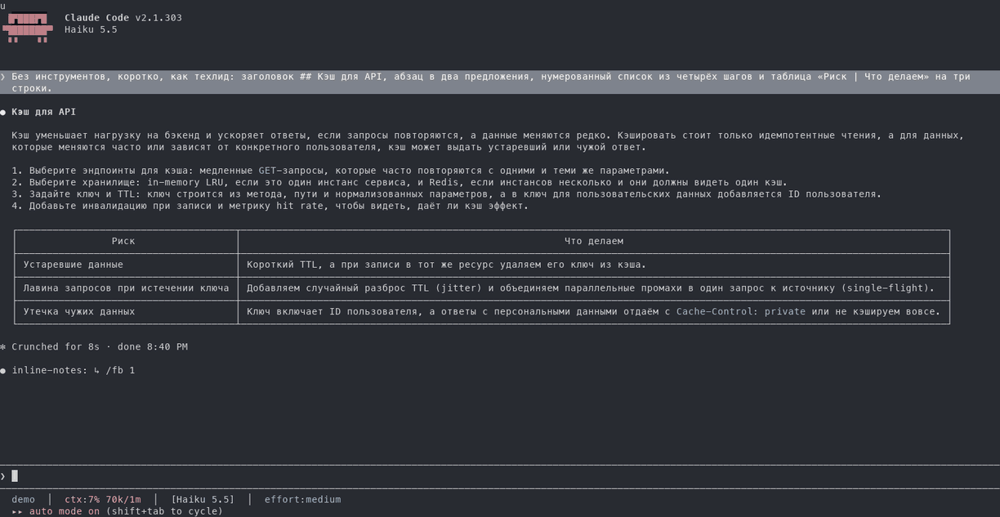
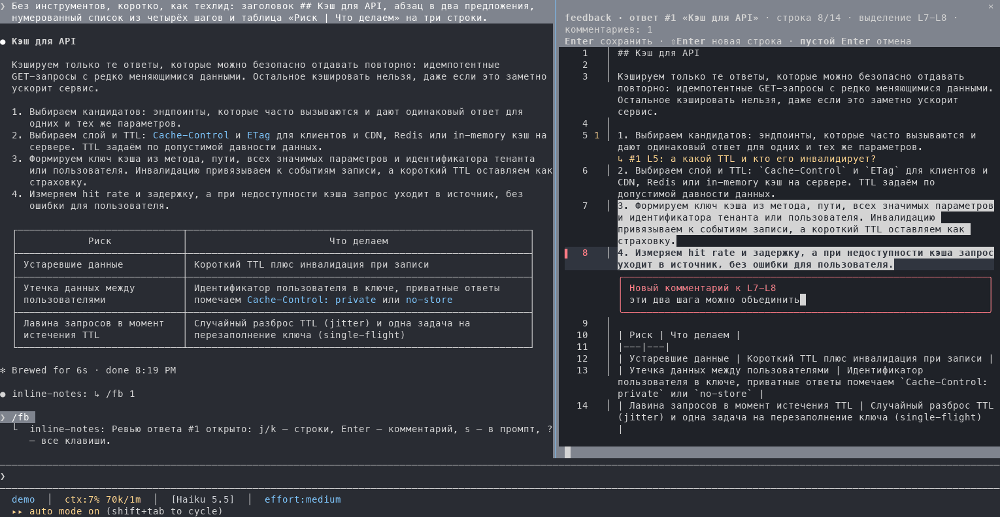
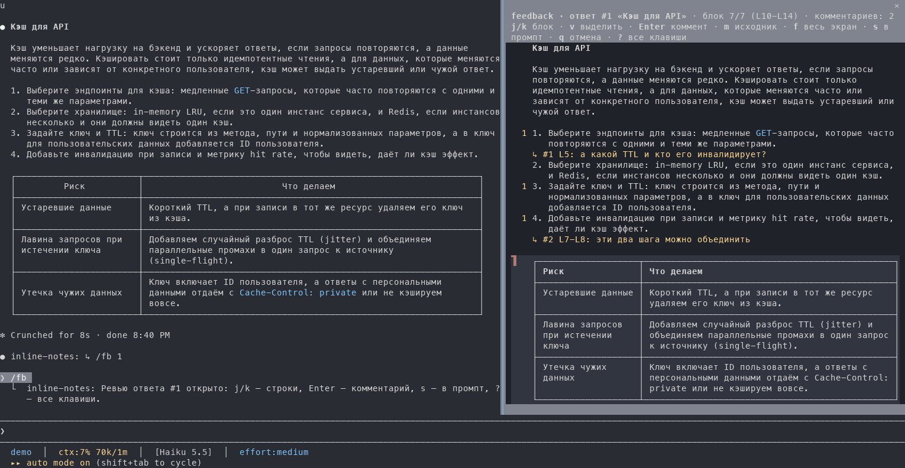
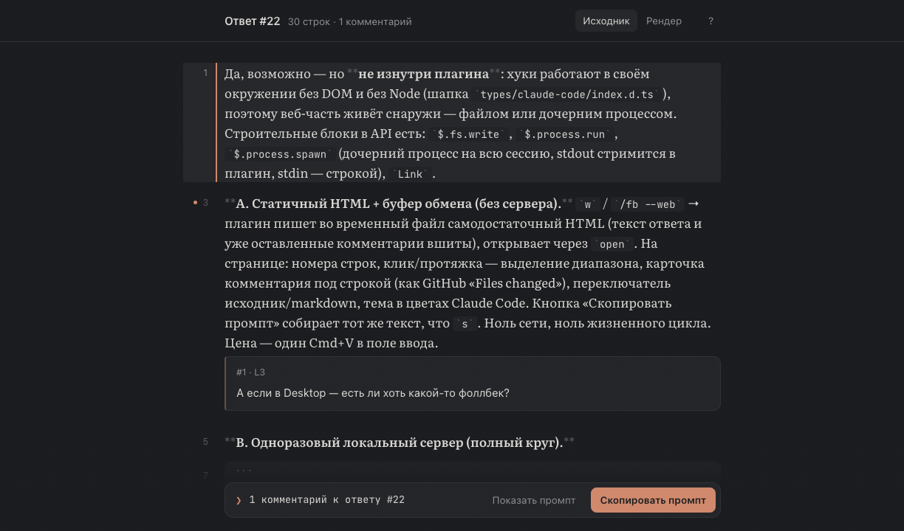
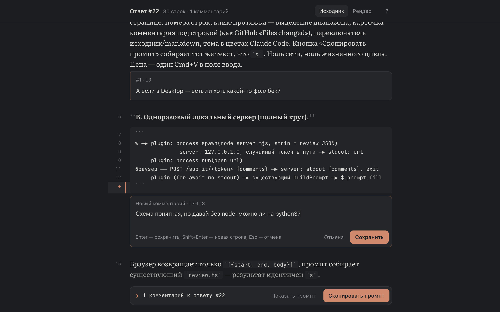
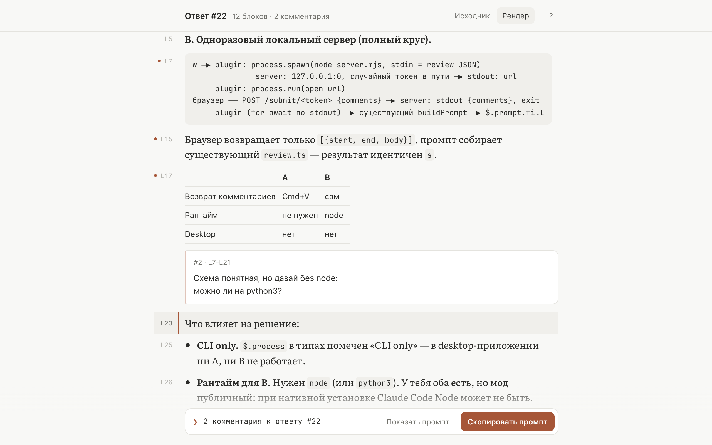

<div align="center">

# inline-notes

**Review Claude's replies line by line, the way you review a pull request.**

`/fb` opens the reply in a pane beside the conversation. You walk its lines, leave comments on a line or a range,<br>
and one keypress sends every comment back to Claude as a single prompt.

[](https://code.claude.com)
[](CHANGELOG.md)
[](LICENSE)

**English** · [Русский](README.ru.md)



</div>

## Why

A long answer from Claude rarely needs one reply. It needs ten small ones: *this step is wrong*, *what TTL?*, *merge these two*. Typing them into the prompt means quoting lines by hand and losing track of what you already said. `inline-notes` lets you point at the line itself, the way code review tools do, and hands Claude a tidy, numbered list where every comment carries the lines it is about.

## Features

- **Line and range comments.** Put a comment on any line, or select a range with `v` first.
- **Two views.** Source lines with numbers, or the reply rendered as Markdown (`m`) with tables and code blocks, where the cursor moves by block.
- **A page in the browser.** `w` opens the review in your browser at full width, set in a reading typeface. Comment by a click or a drag across the line numbers; **Скопировать промпт** (copy prompt) puts the same prompt on the clipboard.
- **One prompt back.** `s` turns every comment, with the lines it quotes, into one prompt in the input box. Review it, paste a screenshot if you want, then press Enter. `/fb --send` skips that step.
- **Keyboard first.** Keys reach the pane right after `/fb`, with no click needed. `j`/`k` and the arrows move, `Enter` comments. Keys also work on the Russian (ЙЦУКЕН) layout.
- **Fits the interface.** The pane takes its accents from your Claude Code theme and picks a dark or light body to match it.
- **Nothing gets lost.** If the prompt can't take the comments (a dialog is open, say), they stay in the review. A second `/fb` never drops a review that still has comments.

| Source view | Rendered view |
| --- | --- |
|  |  |

## In the browser

Claude Code keeps 24 columns for the conversation however wide the pane gets. When a reply needs more room, press `w`: the same review opens as a web page, set at a comfortable reading width.



Click a line number, or drag across several, and type the comment under them. The pane's keys work here too (`j`/`k`, `v`, `Enter`, `e`, `d`, `n`, `m`), and `s` or **Скопировать промпт** puts the prompt on the clipboard. Paste it into Claude Code with ⌘V and press Enter. Comments already made in the pane come along, and a reload of the page keeps the ones made in it.

| Source, dark theme | Rendered, light theme |
| --- | --- |
|  |  |

The page follows your Claude Code theme. It opens from a terminal session (`open` on macOS, `xdg-open` on Linux), and its rendered view and fonts load from cdnjs and Google Fonts.

## Install

At the prompt of a Claude Code terminal session:

```
/plugin install inline-notes --marketplace DaniilMats/inline-notes
```

Answer `y` to add the marketplace, then press Enter to take the user scope, which turns the plugin on for every session. It is active right away.

<details>
<summary>From a shell, or in the desktop app</summary>

From a shell:

```
claude plugin install inline-notes --marketplace DaniilMats/inline-notes
```

The desktop app does not run `/plugin`. Click **+** next to the prompt box, then **Plugins** → **Add marketplace**, enter `DaniilMats/inline-notes`, and click **Add plugin**.

</details>

## Usage

| Command | What it does |
| --- | --- |
| `/fb` | Review the last reply, or reopen the review in progress |
| `/fb N` | Review reply number N. A dim `↳ /fb N` line follows each reply |
| `/fb --send` | `s` sends the comments right away instead of filling the prompt |

### Keys

| Key | Action |
| --- | --- |
| `j` / `k`, `↓` / `↑` | Next / previous line (a block in rendered view) |
| `g` / `G` | Top / bottom |
| `ctrl+d` / `ctrl+u` | Page down / up |
| `v` | Start or clear a range selection |
| `Enter` | Comment on the line or range |
| `e` / `d` | Edit / delete the comment on the line |
| `n` / `N` | Next / previous comment |
| `m` | Switch between source and rendered Markdown |
| `f` | Full-screen pane and back |
| `w` | Open the review in the browser |
| `s` | Put the comments in the prompt |
| `q` | Close the review (press twice if it has comments) |
| `?` | All keys |
| `Esc` | Back to the prompt. The review stays: `/fb` or a click returns to it |

While you type a comment, `Enter` saves it and `Enter` on an empty comment cancels it.

> [!NOTE]
> The interface text is in Russian. The prompt it builds is in Russian too, so Claude usually answers the comments in Russian.

## How it works

`inline-notes` is a Claude Code plugin built on function hooks. `/fb` reads the session's replies, opens a pane, and draws the reviewer in it as a `Client` surface module. That module reads keys raw, which is how the Russian layout maps onto the same commands. A zero-height input field holds the keyboard, so no click is needed. It sits on the cursor's `▌` marker, or at the insertion point of a comment being typed, so the terminal's caret never wanders off to a corner. When you press `s`, the comments become one prompt that quotes the numbered lines each comment is about.

The review state lives in the session's plugin state, so closing the pane with `Esc` loses nothing.

`w` writes [`web/review.html`](web/review.html), with the review inlined as data, to a file in the temp folder and opens it in your browser. The page needs no server: it builds the prompt from the same numbered quotes as `s` and hands it back through the clipboard. Raw HTML in a reply is shown as text, and links open only over http(s) and mailto.

## Development

```sh
git clone https://github.com/DaniilMats/inline-notes
claude --plugin-dir ./inline-notes      # a session with your working copy loaded
claude plugin test ./inline-notes       # the test suite
claude plugin validate ./inline-notes   # manifests and hooks, as the engine reads them
```

The reviewer logic is pure state transitions in [`hooks/review.ts`](hooks/review.ts), and layout arithmetic lives in [`hooks/layout.ts`](hooks/layout.ts). Both are covered by [`tests/fb.test.ts`](tests/fb.test.ts). The browser page is one self-contained file, [`web/review.html`](web/review.html).

## Credits

Started as a port of a `/fb` review extension for the [pi](https://github.com/earendil-works/pi) coding agent.

## License

[MIT](LICENSE) © Daniil Matsyutsya
